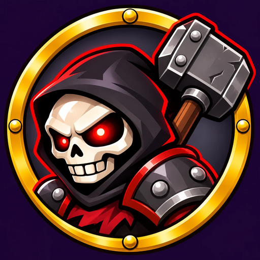
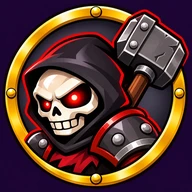
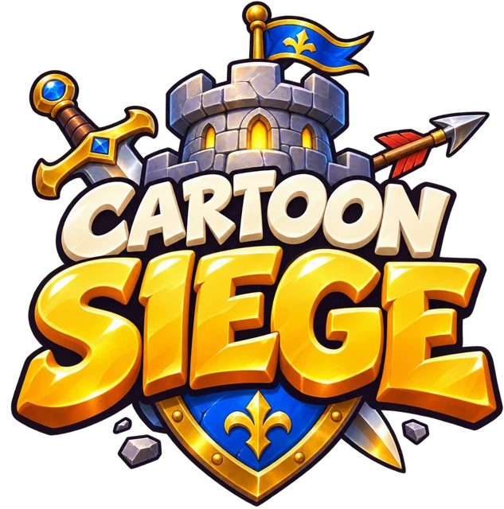

# Cartoon Siege

A free side-scrolling siege game for the browser. Send troops, fire the crossbow, call down powers and storm the enemy fortress across six worlds. It also has a villain campaign and live duels with a friend.

## Run it

```bash
npm install
npm run dev        # http://localhost:5173  (add ?play to open the game at once)
npm run build      # production build into dist/
npm run preview    # serve dist/
npm run typecheck
```

Node 20 or newer.

## Layout

- `index.html`, `privacy.html`: the landing page and privacy page. Their texts are in `src/landing.ts` (EN/ES).
- `src/main.ts`: wires the landing page to the game (audio, settings, language).
- `src/siege/`: the game. `cartoon/model.ts` holds the rules and units, `cartoon/view.ts` the drawing, `cartoon/story.ts` the story scenes, `index.ts` the screens and HUD, and `duel.ts` online duels.
- `src/audio.ts`: synthesised music and sound effects (Web Audio).
- `src/net.ts`: peer-to-peer connection for duels (PeerJS / WebRTC).
- `src/strings.ts`: in-game texts, English and Spanish.
- `public/images/game/`: art.

Saves live in the browser's local storage under `cartoonSiege.*` keys.

## Icons and brand assets

Everything sits in `public/` and is served from the site root.

<p>
  
  
  
</p>

### Icons

| File | Size | Used for |
|---|---|---|
| `public/favicon-32.png` | 32×32 | Browser tab icon (skull badge), on `index.html` and `privacy.html` |
| `public/favicon.webp` | 192×192 | Larger tab icon (skull badge), same pages |
| `public/apple-touch-icon.png` | 180×180 | Home-screen icon on iPhone/iPad (logo), on `index.html` |
| `public/icon-512.png` | 512×512 | Logo icon master; not linked from any page |

### Logo

| File | Size | Used for |
|---|---|---|
| `public/images/logo.webp` | 1225×1238 | Full-size logo; large screens in the landing hero (`srcset`) |
| `public/images/logo-640.webp` | 633×640 | Landing hero logo |
| `public/images/logo-96.webp` | 95×96 | Header logo on the landing and privacy pages (shown at 48×48) |

### Covers and social preview

| File | Size | Used for |
|---|---|---|
| `public/images/og.jpg` | 1200×630 | Social preview (`og:image`) when the link is shared |
| `public/images/cover-landscape.webp` | 1672×941 | Landing background on wide screens (`src/style.css`) |
| `public/images/cover-portrait.webp` | 1024×1536 | Landing background on phones (`src/style.css`) |
| `public/images/cover-square.webp` | 1254×1254 | Square cover; not used by the site |
| `public/images/cover-1920x1080.jpg` | 1920×1080 | Cover, 16:9; not used by the site |
| `public/images/cover-800x1200.jpg` | 800×1200 | Cover, 2:3; not used by the site |
| `public/images/cover-800x800.jpg` | 800×800 | Cover, square; not used by the site |

In-game art (units, backgrounds, UI) lives in `public/images/game/`.

## Deploy

`render.yaml` describes a Render static site: it builds with `npm ci && npm run build` and publishes `dist/`.

© 2026 Álvaro Rodríguez Molina. All rights reserved.
